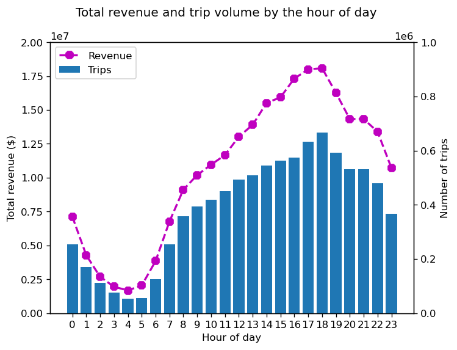
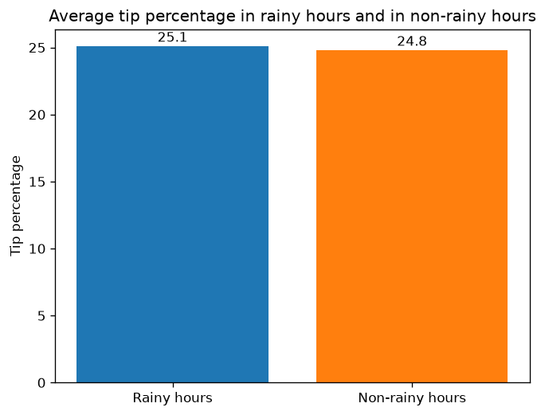
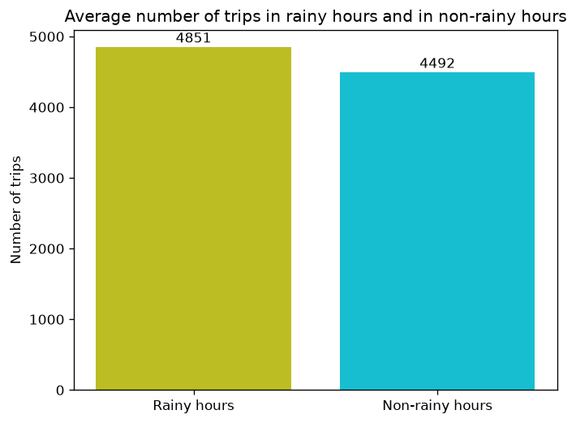
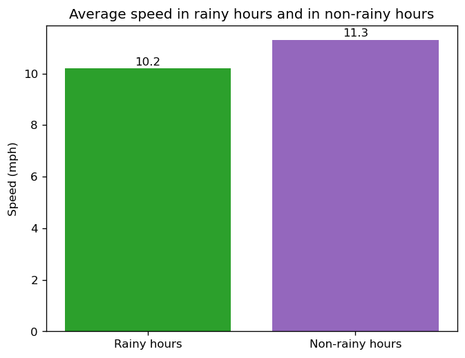
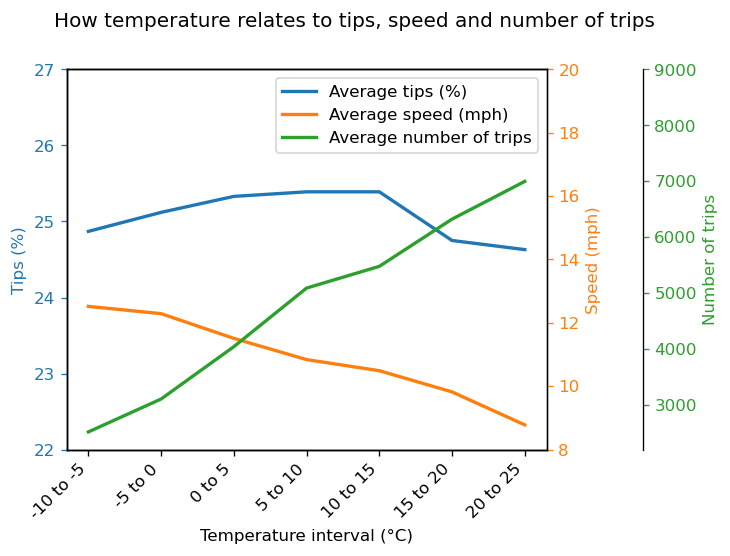

# Project Assignment: NYC Taxi × Weather Analytics with Apache Spark

## About

An analytics pipeline that answers a real question: **does weather affect taxi rides in New York?** A full year of real trip data (2024, 41 million trips) is loaded, cleaned, aggregated, and enriched with hourly weather from a public API and with a zone lookup table. The findings, with numbers and charts, are below.

## Data sources

1. **NYC Yellow Taxi trip records** - official monthly Parquet files, `2024-01` to `2024-12`:
   `https://d37ci6vzurychx.cloudfront.net/trip-data/yellow_tripdata_2024-01.parquet` (and `-02` … `-12`).
   Landing page with docs and data dictionary: https://www.nyc.gov/site/tlc/about/tlc-trip-record-data.page
2. **Taxi Zone Lookup Table** - linked on the same landing page
   (`https://d37ci6vzurychx.cloudfront.net/misc/taxi_zone_lookup.csv`).
3. **Open-Meteo historical weather API** - hourly precipitation and temperature for NYC:
   `https://archive-api.open-meteo.com/v1/archive?latitude=40.71&longitude=-74.01&start_date=2024-01-01&end_date=2024-12-31&hourly=temperature_2m,precipitation&timezone=America/New_York`

   Weather data by [Open-Meteo.com](https://open-meteo.com/), licensed under [CC BY 4.0](https://creativecommons.org/licenses/by/4.0/).

## Setup and run instructions

**Requirements:** Java 17 or 21 (Spark 4 needs Java 17 or newer; tested with Spark 4.2.0 and Java 21), Python 3, and:

```bash
pip install pyspark requests matplotlib
```

**No data is tracked in this repository** - `data/` is gitignored and rebuilt from the three public sources listed above.

**Run** from the repository root, in this order. Spark runs in local mode (`local[*]`), no cluster needed. Each script asks Spark for a 4 GB heap (`spark.driver.memory`), because the 1 GB default runs out of memory on a full year. On a 16-core laptop the whole pipeline takes about 2.5 minutes.

```bash
python 00_download.py
```

It fetches the monthly Parquet files listed in `MONTHS` (12 files, ~660 MB for 2024), the zone lookup CSV and the Open-Meteo weather JSON into `data/`, checking each one after it lands. The weather request covers the same months automatically. Re-running skips files that are already present and intact, so it is safe to repeat; `--force` re-downloads everything.

```bash
python 01_load_and_clean.py
```

It cleans every downloaded month and writes `data/cleaned_trips/`, partitioned by `pickup_date`. Every other script reads that directory, so it must run first; scripts 02–05 are independent of each other and can run in any order.

| Script | What it does |
|---|---|
| `00_download.py` | Downloads the raw trips, zone lookup and weather JSON into `data/` |
| `01_load_and_clean.py` | Loads every downloaded month, applies cleaning rules, adds derived columns |
| `02_core_analytics.py` | Trips/revenue per day, hour, weekday; daily averages |
| `03_weather_enrichment.py` | Joins Open-Meteo hourly weather, rain and temperature analysis; writes the result tables to `findings/` |
| `04_zone_enrichment.py` | Broadcast join with zone lookup, top zones, tips by borough |
| `05_window_functions.py` | Day-over-day change, 7-day rolling average, top-3 busiest hours |

Charts are saved to `figures/` (the images below) and also shown in matplotlib windows.

## Cleaning rules

Applied in [01_load_and_clean.py](01_load_and_clean.py).

**Step 1 - drop incomplete rows.** Rows with a null in any of `tpep_pickup_datetime`, `tpep_dropoff_datetime`, `trip_distance`, `fare_amount`, `total_amount` are dropped. Without this, group-by comparisons stop being apples-to-apples, because different aggregates would be computed over different subsets of rows. (In the 2024 files no row has such a null, so this step removes nothing.)

**Step 2 - drop implausible rows.** A row is rejected if it matches *any* of the rules below:

| Rule condition | Why |
|---|---|
| pickup before the first downloaded month, or on/after the first day after the last one (currently `2024-01-01` to `2025-01-01`) | Only the downloaded months are analysed. The bounds come from the file names, not the data, because the raw data contains trips dated 2001 and 2098 |
| pickup ≥ dropoff | A trip cannot end before (or exactly when) it starts |
| duration > 6 h | Trips that long normally end outside NYC |
| distance ≤ 0 or ≥ 100 miles | Non-positive distance is broken data; 100+ miles is out of scope |
| `fare_amount` ≤ 0 | Broken values, and a zero-division guard for `tip_pct` |
| `total_amount` ≤ 0 | Broken values, and a zero-division guard |

**Result for 2024:**

| | Rows |
|---|---|
| Before cleaning | 41,169,720 |
| pickup outside the period | 56 |
| dropoff not after pickup | 13,510 |
| duration over 6 h | 22,023 |
| bad trip distance | 777,918 |
| non-positive fare | 748,284 |
| non-positive total | 614,406 |
| **After cleaning** | **39,681,144** (3.6% removed) |

Rules are counted independently, so a single bad row can match several of them - the per-rule counts overlap and do not sum to the number of rows removed.

## Result tables

`03_weather_enrichment.py` writes two CSV files to [`findings/`](findings/). Unlike `data/`, this folder is part of the repository.

- [`findings/daily_summary.csv`](findings/daily_summary.csv) - one row per day of 2024, trips joined with weather.
- [`findings/hourly_summary.csv`](findings/hourly_summary.csv) - one row per hour (8,783 rows), with the sums and counts behind every average, so it can be re-aggregated, plus that hour's temperature and precipitation.

| Column of `daily_summary.csv` | Meaning |
|---|---|
| `date` | Pickup date |
| `trips` | Number of trips |
| `revenue` | Sum of `total_amount`, in dollars |
| `avg_tip_pct` | Average tip as a percentage of the fare, card payments only, trip-weighted |
| `avg_speed_mph` | Average trip speed, trip-weighted |
| `precipitation_mm` | Total precipitation that day |
| `rainy_hours` | Hours with at least 0.5 mm of precipitation |
| `temp_mean_c`, `temp_min_c`, `temp_max_c` | Mean, lowest and highest hourly temperature (°C) |

Like the rest of the weather analysis, both tables leave out trips at 55 mph or more (16,278 trips, 0.04% of the cleaned data), so their daily trip counts are slightly lower than those from `02_core_analytics.py`.

## Findings

### Trips volume and revenue by hour of the day

Trips peak at 6 p.m. (2.82 million over the year) and revenue at 5–6 p.m. ($80.5M and $80.1M) - the evening rush after work. The quietest hour is 4 a.m. (227 thousand trips, $7.3M):



### Trips and revenue per day of week

Seems unobviously, but Thursday is the busiest day of the week in both revenue and number of trips. The "Thursday is a little Friday" rule applies. Saturday has the second-most trips but only the fifth-highest revenue, and Monday is the quietest day.

| Day of the week | Total number of trips | Total revenue per day of week |
|---|---|---|
| Thursday | 6,199,225 | $180,454,932 |
| Wednesday | 5,908,229 | $169,582,520 |
| Friday | 5,864,589 | $167,688,606 |
| Tuesday | 5,695,996 | $162,953,548 |
| Saturday | 6,008,126 | $160,544,057 |
| Sunday | 5,075,051 | $147,826,579 |
| Monday | 4,929,928 | $147,517,415 |

### Pickup and dropoff zones

| # | Top pickup zones | Pickups | Top dropoff zones | Dropoffs |
|---|---|---|---|---|
| 1 | Upper East Side South | 1,871,246 | Upper East Side North | 1,754,878 |
| 2 | JFK Airport | 1,869,572 | Upper East Side South | 1,682,186 |
| 3 | Midtown Center | 1,860,931 | Midtown Center | 1,492,615 |
| 4 | Upper East Side North | 1,690,881 | Times Sq/Theatre District | 1,255,274 |
| 5 | Midtown East | 1,381,045 | Murray Hill | 1,176,474 |
| 6 | Times Sq/Theatre District | 1,337,784 | Midtown East | 1,148,151 |
| 7 | Penn Station/Madison Sq West | 1,323,784 | Lincoln Square East | 1,110,258 |
| 8 | Lincoln Square East | 1,280,809 | Upper West Side South | 1,103,511 |
| 9 | LaGuardia Airport | 1,260,480 | East Chelsea | 1,038,988 |
| 10 | Murray Hill | 1,139,720 | Lenox Hill West | 1,035,010 |

Both airports are among the top pickup zones but not among the top dropoff zones: yellow cabs collect many passengers at the airport taxi ranks.

Average tip percentage by pickup borough (card payments only):

| Borough | Average tip | Card trips | Share with no tip |
|---|---|---|---|
| Manhattan | 25.45% | 26,957,762 | 4% |
| Queens | 20.95% | 2,785,915 | 8% |
| Staten Island | 16.43% | 163 | 33% |
| Brooklyn | 7.72% | 267,173 | 70% |
| Bronx | 1.44% | 61,587 | 95% |

Manhattan riders tip the most. The very low averages in Brooklyn and the Bronx come almost entirely from trips that record no tip at all (70% and 95%); that probably says more about how those card trips are paid or recorded than about the riders, which this data cannot tell apart. Staten Island has too few trips to compare.

### During rainy hours

**Rainy hour = at least 0.5 mm of precipitation in that hour.** That is the UK Met Office boundary between "slight" and "moderate" rain. It leaves out trace amounts: the weather data comes in 0.1 mm steps, and the smallest values are model estimates for a whole grid cell, the least reliable ones and often drizzle nobody notices. At this threshold **586 of 8,783 hours (6.7%)** count as rainy.

All figures below are **trip-weighted**: the hourly aggregates carry sums and counts, which are pooled and divided once. Averaging the per-hour averages instead would give a quiet 4 a.m. hour the same weight as a 6 p.m. peak.

There is no meaningful tip effect: 25.10% in rainy hours against 24.80% in dry ones, a 0.3 percentage-point difference.



The trip volume is 8.0% higher when it rains (4,851 vs 4,492 trips per hour):



The speed is 5.1% lower when it rains (10.36 vs 10.92 mph):



**The conclusions do not depend on the exact threshold.** The same comparisons at four thresholds (rainy hours vs dry hours):

| Threshold | Rainy hours | Tips | Speed | Trip volume |
|---|---|---|---|---|
| ≥ 0.1 mm | 1,302 | +0.6% | −4.0% | +5.2% |
| **≥ 0.5 mm** | **586** | **+1.2%** | **−5.1%** | **+8.0%** |
| ≥ 1.0 mm | 338 | +1.8% | −5.4% | +12.6% |
| ≥ 2.5 mm | 140 | +2.0% | −4.7% | +15.0% |

Trips are slower at every threshold, and demand rises with every threshold - the heavier the rain, the bigger the rise. Tips move by at most 2% (half a percentage point).

### Temperature brackets

| Temperature (°C) | Average tip | Average speed (mph) | Trips per hour | Hours |
|---|---|---|---|---|
| −15 to −10 | 24.89% | 11.51 | 2,722 | 19 |
| −10 to −5 | 25.01% | 11.84 | 2,820 | 175 |
| −5 to 0 | 25.03% | 11.75 | 3,429 | 732 |
| 0 to 5 | 25.06% | 11.17 | 4,061 | 1,217 |
| 5 to 10 | 25.08% | 10.95 | 4,643 | 1,433 |
| 10 to 15 | 24.75% | 10.80 | 4,636 | 1,233 |
| 15 to 20 | 24.56% | 11.18 | 4,262 | 1,396 |
| 20 to 25 | 24.62% | 10.75 | 4,720 | 1,486 |
| 25 to 30 | 24.76% | 10.15 | 5,697 | 858 |
| 30 to 35 | 24.71% | 9.82 | 6,142 | 221 |
| 35 to 40 | 24.87% | 9.60 | 6,906 | 13 |

The number of trips goes up and the speed goes down as it gets warmer: from about 2,800 trips per hour at −10 to −5 °C to 5,700 at 25 to 30 °C, while speed falls from 11.8 to 10.2 mph. The tip percentage stays between 24.6% and 25.1% in every bracket - the tips axis on the chart is stretched, so its line looks more dramatic than it is.



The two extreme brackets hold only 19 and 13 hours, so the coldest-to-warmest comparison printed by the script (speed −16.6%, trips +153.7%) is fragile; the trend across the well-filled middle brackets is the safer reading.

### Summary

Across 2024 - 39.7 million cleaned trips and 8,783 hours with weather - rain changes how New Yorkers ride but not how they tip. In hours with at least 0.5 mm of rain, trips are 5.1% slower (10.36 vs 10.92 mph) and there are 8.0% more of them (4,851 vs 4,492 per hour). The heavier the rain, the stronger the demand effect: +5.2% for any measurable rain, +15.0% at 2.5 mm. Card tips stay essentially flat, 25.10% against 24.80%. Warm weather goes with more trips - about 2,800 per hour at −10 to −5 °C against 5,700 at 25 to 30 °C - and lower speeds (11.8 vs 10.2 mph), while tips stay between 24.6% and 25.1% at every temperature. All of these are associations, not proven effects: rainy and hot hours fall at particular times of day and year, and the analysis does not control for that.

### Limitations

- **Time of day and season are not controlled.** Rainy and dry hours are compared across the whole day and year; comparing them within the same hour of day would separate the weather from the daily rhythm.
- **One weather point for the whole city.** The weather is a model value for a single grid point in lower Manhattan (40.71 N, 74.01 W).
- **Daylight-saving hours.** On 10 March the clocks skip 2 a.m., so the weather data has one hour (`2024-03-10 02:00`) with no trips; the join drops it, which is why the script reports 8,783 joined hours out of 8,784. On 3 November the clocks repeat 1 a.m., so the `2024-11-03 01:00` hour holds two real hours of trips (8,478, against 6,500 and 5,173 at the same hour on the neighbouring Sundays) and is matched to a single weather row.

## Questions

1. **Cash trips:** the `tip_amount` field is effectively never filled for cash trips: 5,276,252 of 5,276,521 cash trips in 2024 (99.995%) record a tip of 0.0, against 5.6% of card trips. Cash tips go straight to the driver and never pass through the meter, so they are not in the data. Including cash rides would mix real zeros with missing values: the average tip would fall in proportion to how many riders pay cash, so the analysis would measure the payment mix instead of tipping, without any error to warn you.

2. **Difference between transformations and actions:** the data is loaded when Spark is triggered by action (`.show()`, in that case). For the actual computation **an action** is always needed, because transformation operations are lazy evaluated - the code computes only when the answer is needed, otherwise program delays the task:

```bash
   df = spark.read.parquet("data/cleaned_trips")

   daily = df.groupBy("pickup_date").agg(
      f.count("*").alias("trips_per_day"), 
      f.round(f.sum("total_amount")).alias("revenue_per_day")
   ).sort("pickup_date")
```

&emsp;&emsp;wait until action (lazy evaluation)

```bash
   daily.show()
```

&emsp;&emsp;action is here, can be executed.

3. For the **broadcast join** *no shuffle is required*. Spark takes the smaller table, broadcasts (copies) it to every executor in the cluster, then builds an in-memory hash table on each executor. The larger table stays partitioned, and each executor performs a local hash lookup to find matches. Make sense when one side is smaller than `spark.sql.autoBroadcastJoinThreshold` (default 10MB).

4. **Narrow and wide transformations:** shuffles usually happen with wide transformation and never with narrow transformation.

&emsp;&emsp;Narrow transformation:

```bash
   df.filter((f.col("speed_mph") < speed_threshold))
```

&emsp;&emsp;Wide transformation (need a shuffle):

```bash
   df.groupBy("pickup_date")
```

&emsp;&emsp;But "number of wide transformations" and "number of shuffles" are not always the same number. For example join usually has two input tables. It is one wide transformation, but it needs both sides shuffled.

5. **Cleaned output partitioned by date:** `pickup_date` is the natural write key, and adding new months only adds new folders. It pays off in queries that filter on the date: Spark reads only the matching folders. Measured on the full year, one day's revenue with `filter(pickup_date == "2024-07-04")` reads 1 of 366 files (1.6 MB, 0.44 s), while the same question asked through the raw timestamp, `to_date(tpep_pickup_datetime) == "2024-07-04"`, reads all 366 files (964.5 MB, 1.75 s). None of the pipeline's own queries filter by date, though, so every script still reads all 366 folders. Daily partitions are also small (about 2.6 MB per file), and each file adds listing and opening overhead to full scans; at this data volume a production table would use monthly partitions with rows sorted by pickup time.
